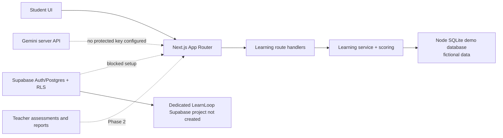

# Architecture — LearnLoop AI

**Status:** Phase 1 student-learning path is implemented in local demo mode. Supabase auth/database, teacher assessments, Gemini integration, multi-role authorization and deployment are target architecture only.

## Implemented source modules

- `app/` owns Next.js pages, shared layout, route-level loading/error states, and the `/api/learn/*` plus health route handlers.
- `components/` contains the navigation shell, student progress/history views, session runner, answer-save feedback, hints, and result explanations.
- `lib/learning/` contains the Python Fundamentals concept/question bank and pure score/gap calculation.
- `lib/services/learning.ts` implements fictional-student session creation/resume, server-side answer persistence, completion/scoring, fresh question selection, and progress/history queries.
- `lib/db/demo-store.ts` initializes local Node `node:sqlite` schema and fictional question seed data. The adapter refuses production mode.
- `tests/` and `scripts/` contain score/catalog unit tests and a temporary-DB HTTP end-to-end verifier.

## Target modules (not yet implemented)

- `lib/auth/` for Supabase session/role checks and controlled demo identity handling.
- `features/assess/` for teacher authoring, class assignment, timed student attempts, submission review and analytics.
- `lib/ai/` for Gemini server-only clients, schemas, validation and curated fallbacks.
- Supabase migrations/policy tests for the durable cloud schema/RLS boundary.

## Current data flow

## Security and trust boundaries

Current local demo routes use one fixed fictional student identity and are **not authentication or multi-user authorization**. Request inputs are validated, each local session is checked against the fixed demo student, assigned session question IDs/options are enforced, and active responses do not expose correct answers or explanations. The server stores saved answers and computes final scores; repeat finalization is idempotent and post-completion answer writes are rejected. Never use real learner data in demo mode.

Production identity must come from validated Supabase Auth claims plus trusted profile/class memberships. The database RLS layer must add a separate row boundary. Teacher/organization data, answer keys, deadlines, final scores and Gemini credentials must remain server-side and only be exposed to authorized actors. Do not claim those future protections are implemented or tested until their project and flows exist.

## Current environment reality

Managed server is enabled on port 3000; managed database is disabled. Dedicated Supabase provisioning was blocked by the selected organization's free-tier active-project limit. Local `node:sqlite` is experimental in the pinned Node version and is only a fictional-data development/demo fallback. Gemini, teacher assessment workflows, Supabase auth/RLS and production deployment are not yet connected.
