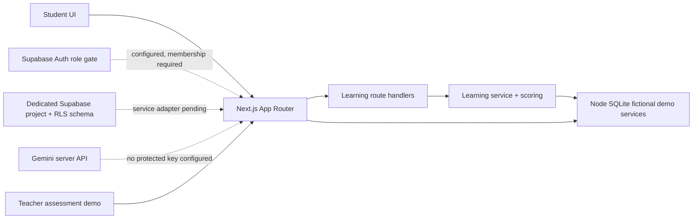

# Architecture — LearnLoop AI

**Status (2026-10-11):** student learning and teacher assessments run in fictional SQLite demo mode. Dedicated Supabase project, RLS-enabled schema and cloud-mode assessment role gates exist, but services are not PostgreSQL-backed and authenticated row-level behavior is unverified. Gemini/deployment remain unconfigured.

## Implemented source modules

- `app/` owns Next.js pages, shared layout, route-level loading/error states, and the `/api/learn/*` plus health route handlers.
- `components/` contains the navigation shell, student progress/history views, session runner, answer-save feedback, hints, and result explanations.
- `lib/learning/` contains the Python Fundamentals concept/question bank and pure score/gap calculation.
- `lib/services/learning.ts` implements fictional-student session creation/resume, server-side answer persistence, completion/scoring, fresh question selection, and progress/history queries.
- `lib/db/demo-store.ts` initializes local Node `node:sqlite` schema and fictional question seed data. The adapter refuses production mode.
- `tests/` and `scripts/` contain score/catalog unit tests and a temporary-DB HTTP end-to-end verifier.

## Implemented scaffolding and outstanding modules

- `lib/auth/` includes Supabase session/role checks and route authorization gates; do not equate these with cloud persistence or proven RLS.
- `features/assess/` behavior exists for demo quiz authoring, timed attempts, review and analytics. Production class assignment and tenant-scoped workflow integration remain outstanding.
- `lib/ai/` for Gemini server-only clients, schemas, validation and curated fallbacks.
- Supabase schema and grant/policy migrations are applied; authenticated RLS policy tests and data repositories remain outstanding.

## Current data flow

## Security and trust boundaries

Current local demo routes use one fixed fictional student identity and are **not authentication or multi-user authorization**. Request inputs are validated, each local session is checked against the fixed demo student, assigned session question IDs/options are enforced, and active responses do not expose correct answers or explanations. The server stores saved answers and computes final scores; repeat finalization is idempotent and post-completion answer writes are rejected. Never use real learner data in demo mode.

Cloud-mode assessment handlers now derive identity from `auth.getUser()` and role from trusted organization memberships. However those handlers still call SQLite-backed services, and no signed-in RLS allow/deny test has passed. Teacher/organization data, answer keys, deadlines, final scores and Gemini credentials must remain server-side and only be exposed to authorized actors. Do not enable real learner data until tenant-aware repositories and policy tests pass.

## Current environment reality

Managed server is enabled on port 3000; managed database is disabled. Dedicated Supabase project `rlglcgtamqwqzmkitdtn` is healthy, with three migrations applied and 14/14 public tables RLS-enabled. Local `node:sqlite` is experimental and remains the only application data store. Gemini and production deployment are not configured.

 
## Supabase foundation (scaffolded, not activated)

- `lib/supabase/server.ts` and `lib/supabase/browser.ts` create cookie-aware SSR and browser clients from public project URL/publishable key.
- `proxy.ts` refreshes/validates Supabase sessions when project settings are configured; it intentionally leaves the fictional demo available when no project credentials exist.
- `lib/auth/guards.ts` resolves roles from trusted organization membership rows and provides 401/403 response helpers for handlers.
- `app/sign-in` implements email magic-link initiation, `app/auth/callback` exchanges the callback code, and `/api/auth/me` reports the authenticated profile.
- Migrations `202610100001`–`003` establish profile/org/class/assessment/audit schema, tightened grants/RLS policy correlations, private helpers, and a safe quiz DTO RPC.

The current teacher/student quiz services still use SQLite. The Supabase schema/client scaffolding is not a cloud persistence adapter; membership bootstrap, class/org administration, atomic Postgres attempt grading, mandatory sign-in routing, and authenticated RLS tests remain incomplete. Do not enable real learner workflows until those are implemented and verified.
